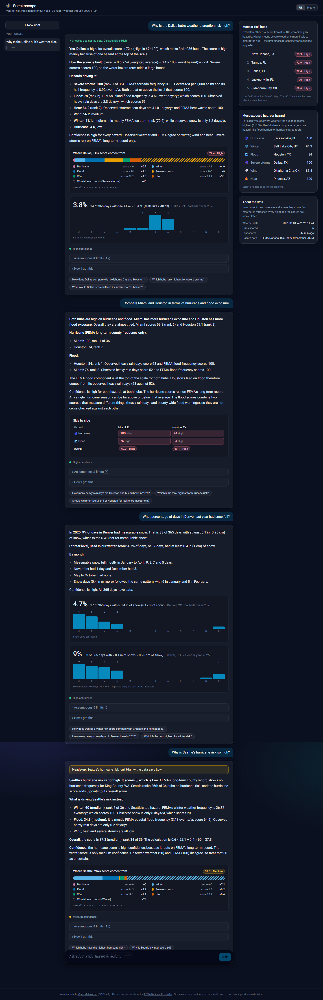

# Sneakoscope


A weather risk intelligence agent for a logistics company's US distribution hubs.
Analysts chat with it to find out which hubs are most exposed to severe weather, compare hubs,
and understand *why* a hub is risky, to help decide where to invest in resilience upgrades.

> 🚧 Work in progress. Built step by step. See [docs/plan.md](docs/plan.md).

## Docs
- [Plan](docs/plan.md): architecture, tables, steps
- [Decision log](docs/decisions.md): every choice and why
- [Assumptions, uncertainty & scope](docs/assumptions.md)
- [Design](docs/design.md)
- [AI session log](docs/session/): the full conversation with the coding agent

## Run locally
Requirements: Node 22+, a Supabase project.

```bash
npm install
cp .env.example .env.local     # then fill in the values (see comments in the file)
npm run db:check               # verifies the database connection: lists the hubs
npm run dev                    # http://localhost:3000
```

## Scripts
| Command | What it does |
|---|---|
| `npm run dev` | Start the app locally |
| `npm test` | Unit tests (Vitest) |
| `npm run typecheck` | TypeScript check |
| `npm run lint` | ESLint (includes the rule keeping `src/core` free of Next.js) |
| `npm run db:check` | Connect to Supabase and list hubs per region |
| `npm run ingest` | Fetch FEMA + Open-Meteo data for all active hubs (incremental; the first full load takes about 1 h because of Open-Meteo's rate limits) |
| `npm run ingest -- --hub=dallas,denver` | Same, for selected hubs only |
| `npm run ingest -- --refresh-fema` | Re-fetch FEMA records for every hub (e.g. after a new NRI release) |
| `npm run score` | Re-score all hubs from stored data (no API calls). The ingest runs this automatically. |
| `npm run ask -- "question"` | Ask the real agent from the terminal (add `--session=<id>` for a follow-up, `--metric` for metric units) |
| `npm run fema:anchors` | Recompute the national 95th-percentile FEMA anchors (for review before changing `scoring/config.ts`) |
| `npm run session:export -- <file.jsonl>` | Export the AI session log to `docs/session/` (scrubbed) |

## The app


More screenshots: [start screen](docs/screenshots/desktop-start.png) · [phone](docs/screenshots/phone-start.png).
Ask in plain language. Every number comes from deterministic, tested code, and the agent says when the data is unsure.
Use the **US / Metric** switch to change units, and the side nav to reopen this browser's earlier chats.

## API
Every route requires the site login (HTTP Basic Auth: `APP_USERNAME` / `APP_PASSWORD`), except the cron route.

| Route | What it does |
|---|---|
| `POST /api/chat` | Body `{ "sessionId": null \| "<uuid>", "message": "…", "units": "us" \| "metric" }`. Streams the AI SDK chat protocol: `data-session`, `data-progress`, answer text, then `data-answer` (validated) or `data-error`. |
| `GET /api/widgets` | Top 5 hubs, the leading hub per hazard, data freshness. |
| `GET /api/cron/ingest` | Nightly job (Vercel Cron, 06:00 UTC): fetch new weather, then re-score. Needs `Authorization: Bearer <CRON_SECRET>`. |

Errors are always friendly JSON: `{ "error": { "code", "message", "hint", "retryable" } }`.

```bash
curl -u "$APP_USERNAME:$APP_PASSWORD" -H "Content-Type: application/json" \
  -d '{"sessionId":null,"message":"Which Midwest hubs are most exposed to winter?","units":"us"}' \
  http://localhost:3000/api/chat
```

## Evals
```bash
npm run eval                                   # 13 cases on OPENROUTER_MODEL, about 3 min, about $1 on Sonnet
npm run eval -- --model=openai/gpt-6.1-terra   # try another model
npm run eval -- --repeat=3                     # consistency check
npm run eval -- --url=https://your-app.vercel.app   # test a deployment
npm run eval -- --no-judge                     # skip the independent judge
npm run eval -- --rejudge=evals/results/<file>.json   # re-check + re-judge saved answers (cents, no agent calls)
```
Prints pass/fail per case and check, plus soft metrics (tool calls, duplicates, latency, tokens, cost), and exits 1 on failure.
Every answer is also graded by an **independent judge** (`JUDGE_MODEL`, a cheap model from another provider) against
the actual tool results. Only its faithful-to-data score (≥ 4) is a hard check. Before each run the judge must catch
2 planted bad answers, or the report flags it as unreliable.
Expected values are computed from the live data at run time. Latest results: [docs/evals.md](docs/evals.md).

## Database
SQL migrations live in [supabase/migrations/](supabase/migrations/). Apply them in order to a fresh
Supabase project (SQL editor or Supabase CLI). The second migration seeds the 36 hubs.

## Data attribution
Weather data by [Open-Meteo.com](https://open-meteo.com/) (CC BY 4.0). Hazard data: FEMA National Risk Index.
