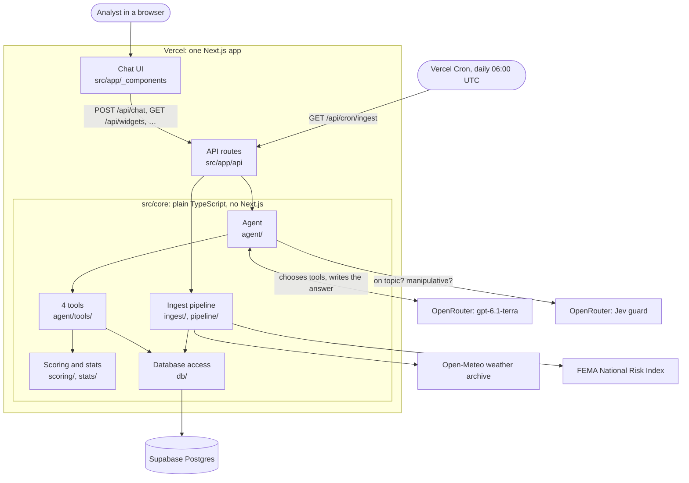
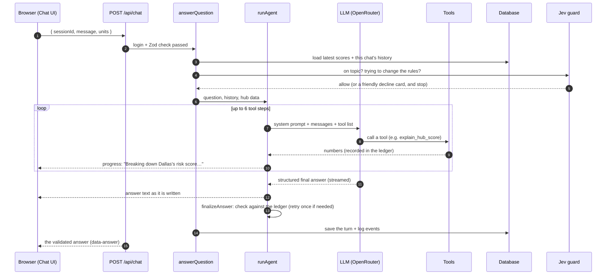

# Design

How Sneakoscope is built, and why. This page is written for someone who has never seen the code. Every part links
to the folder, file or line that does the work. Every choice is explained in plain words here, and the full reasoning
behind each one is in the [decision log](decisions.md) (D-numbers like **D56** point there).

## Contents
1. [The big picture](#1-the-big-picture)
2. [Architecture: the parts and how they talk](#2-architecture-the-parts-and-how-they-talk)
3. [How the LLM is kept from inventing numbers](#3-how-the-llm-is-kept-from-inventing-numbers)
4. [One question, end to end](#4-one-question-end-to-end)
5. [How a hub's risk score is computed](#5-how-a-hubs-risk-score-is-computed)
6. [Where the data comes from: ingest and the nightly job](#6-where-the-data-comes-from-ingest-and-the-nightly-job)
7. [Data storage: tables, and why Postgres](#7-data-storage-tables-and-why-postgres)
8. [Repository structure](#8-repository-structure)
9. [Errors, security and limits](#9-errors-security-and-limits)
10. [Evals, and how the model was chosen](#10-evals-and-how-the-model-was-chosen)
11. [Ten decisions that shaped it](#11-ten-decisions-that-shaped-it)
12. [Trade-offs, and what I'd do next](#12-trade-offs-and-what-id-do-next)

---

## 1. The big picture
Analysts at a logistics company ask, in plain English, which of the company's **36 US distribution hubs** are most
exposed to severe weather. For example: *"Which Midwest hubs are most exposed to winter disruption?"* or *"Why is
Dallas high risk?"*. The answers help them decide where to invest in resilience upgrades.

**The one rule everything is built around:** *the LLM never produces a number.* Every score, rank, count and
percentage is calculated by plain, tested TypeScript. The LLM only decides **which tool to call** and **explains what
the tool returned**. Then code checks the explanation before anyone sees it.

## 2. Architecture: the parts and how they talk



| Part | Where | What it does | Talks to |
|---|---|---|---|
| **Chat UI** | [src/app/_components/](../src/app/_components/) | One screen, three framed panels: earlier chats, the conversation, the overview. The page never scrolls; each panel scrolls inside itself (bottom tabs on phones). Voice in and out uses the browser's speech APIs ([src/app/_lib/speech.ts](../src/app/_lib/speech.ts), D127). Entry: [`SneakoscopeApp`](../src/app/_components/SneakoscopeApp.tsx#L43) | Only our own API routes, never the LLM |
| **API routes** | [src/app/api/](../src/app/api/) | Thin: validate the request with Zod, call `src/core`, turn errors into friendly JSON | `src/core` |
| **Guard** | [src/core/guard/](../src/core/guard/) | Checks each message with Jev before the agent runs; declines off-topic or manipulative ones | OpenRouter (Jev) |
| **Agent** | [src/core/agent/](../src/core/agent/) | Runs the LLM with tools, checks the answer, retries once | OpenRouter, the tools |
| **Tools** | [src/core/agent/tools/](../src/core/agent/tools/) | `rank_hubs`, `compare_hubs`, `get_weather_stat`, `explain_hub_score`. They compute; the LLM only calls them | Scoring, stats, database |
| **Scoring and stats** | [src/core/scoring/](../src/core/scoring/), [src/core/stats/](../src/core/stats/) | Pure functions: weather days → hazard scores → overall score, level, confidence | Nothing (pure) |
| **Ingest pipeline** | [src/core/ingest/](../src/core/ingest/), [src/core/pipeline/](../src/core/pipeline/) | Fetches new weather + FEMA data, then re-scores every hub | Open-Meteo, FEMA, database |
| **Database access** | [src/core/db/](../src/core/db/) | One small "repository" file per table | Supabase |

**Why `src/core` has no Next.js in it:** the agent and scoring can then run and be tested on their own: from unit tests,
from `npm run ask` in a terminal, and from the evals. An ESLint rule in [eslint.config.mjs](../eslint.config.mjs)
fails the build if anything in `src/core` imports Next.js or React (D31).

## 3. How the LLM is kept from inventing numbers
Five layers, each in code:

1. **Tools do all the math.** The LLM can't compute a score. It has to call a tool, and the tool returns finished
   numbers from tested functions. Even differences between hubs are computed for it: `rank_hubs` returns a `spread`,
   and `compare_hubs` returns `gaps` ([`scoreSpread`](../src/core/scoring/ranking.ts#L91), D98).
2. **Every input and output has a strict shape (Zod).** Each tool's input is a Zod schema, and so is the final answer
   the LLM must return: [`llmAnswerSchema`](../src/core/agent/answerSchema.ts#L28). It has the answer text, hubs
   mentioned, the numbers used, the premise claim, confidence, assumptions, limitations, follow-ups, an optional
   recommendation, and the out-of-scope flag. An answer that doesn't fit the shape is rejected.
3. **A ledger records every tool result.** [`ToolLedger`](../src/core/agent/ledger.ts#L112) is the ground truth for one
   answer: which hubs and numbers the tools actually returned. In a follow-up it also includes the earlier turns' results
   (D65).
4. **Code checks the answer against the ledger:** [`finalizeAnswer`](../src/core/agent/finalizeAnswer.ts#L40).
   - *Hard checks* (on failure, the LLM gets one retry with the list of problems): every hub mentioned and every number
     in `dataUsed` must appear in the ledger. A recommendation needs data. A premise must be about a real hub.
   - *Soft check* (a warning, logged and counted by the evals): numbers in the free text that no tool returned.
   - If the retry also fails, the user gets a clear, friendly error, never an unchecked answer
     ([`runAgent`](../src/core/agent/runAgent.ts#L171)).
5. **Code, not the LLM, sets the sensitive fields.** Confidence is recomputed from the data. The premise verdict
   ("you said Dallas is high; the data says…") is decided by comparing against the real level. The standing data
   caveats are attached. Every recommendation gets a fixed disclaimer the LLM can't soften
   ([`RECOMMENDATION_DISCLAIMER`](../src/core/agent/config.ts#L27)).

The evals then test all of this from the outside (section 10).

## 4. One question, end to end



Step by step, with the code:

1. **The browser sends the question.** [`SneakoscopeApp`](../src/app/_components/SneakoscopeApp.tsx#L43) uses the AI SDK's
   `useChat` to `POST /api/chat` with `{ sessionId, message, units }`. The session id lives in the browser's
   localStorage, so earlier chats can be reopened from the side menu.
2. **The route validates and hands off.** [`POST`](../src/app/api/chat/route.ts#L28) validates the body with Zod ([`chatRequestSchema`](../src/core/api/chatStream.ts#L19)), and starts a
   stream ([`buildChatStream`](../src/core/api/chatStream.ts#L55)).
3. **Context and memory are loaded.** [`answerQuestion`](../src/core/agent/answerQuestion.ts#L71) loads the latest score
   for every hub ([`loadAgentContext`](../src/core/agent/context.ts#L58)) and the last 5 turns of this chat
   ([`loadHistory`](../src/core/db/chatRepository.ts#L54)).
4. **The guard checks the message** (Step 11, D118). Before the paid agent runs, [`runGuard`](../src/core/guard/jevGuard.ts#L243)
   asks Jev, a small yes/no decision model, two questions: *is this about weather risk for our hubs* (for a follow-up,
   Jev also sees the last 2 turns, so "why that one?" counts), and *does it try to change the assistant's rules*. If
   it's off topic or manipulative, the person gets a friendly card with example questions
   ([`guardDeclineAnswer`](../src/core/guard/jevGuard.ts#L169)) and the agent never runs. The check takes about 0.3 s;
   if Jev is slow (over 2 s) or down, the message goes through (fail open).
5. **The agent runs.** [`runAgent`](../src/core/agent/runAgent.ts#L171) builds the system prompt
   ([`buildSystemPrompt`](../src/core/agent/systemPrompt.ts#L27): rules, the scoring method, the hub list) and the
   tools ([`buildTools`](../src/core/agent/tools/index.ts#L22)), then calls the LLM in
   [`attempt`](../src/core/agent/runAgent.ts#L86). Limits: 6 tool steps, 25 s per step, 60 s in total
   ([`AGENT_LIMITS`](../src/core/agent/config.ts#L9)).
6. **Tools compute.** Every tool call goes through [`runTool`](../src/core/agent/tools/shared.ts#L61). It reports progress
   to the browser, records the result in the ledger, and answers an exact repeat of an earlier call with a short "same as
   before" note instead of re-running it (D96).
7. **The answer streams.** The LLM's answer text streams to the browser as it's written, so the analyst sees it appear.
8. **Code checks it.** [`finalizeAnswer`](../src/core/agent/finalizeAnswer.ts#L40) runs the checks from section 3. If
   they fail, the browser shows "Double-checking my numbers…" while the LLM gets one retry.
9. **Saved and logged.** The turn, including tool results, is saved for follow-ups
   ([`saveTurn`](../src/core/db/chatRepository.ts#L108)), and an `agent.answered` event is logged with the tools used,
   tokens and confidence ([`recordEvent`](../src/core/db/eventsRepository.ts#L117)).
10. **The browser shows the checked answer.** Visuals (score breakdown, comparison grid, monthly pattern) are drawn
   **from the tool results**, not from anything the LLM wrote ([src/app/_components/visuals/](../src/app/_components/visuals/)).

## 5. How a hub's risk score is computed
All numbers live in one file, [src/core/scoring/config.ts](../src/core/scoring/config.ts). The method:

- **Six hazards, weighted** ([`HAZARD_WEIGHTS`](../src/core/scoring/config.ts#L77)): hurricane 25%, winter 20%,
  flood/heavy rain 20%, severe storms (tornado + hail) 15%, wind 10%, heat 10%.
- **Each hazard is scored 0–100 on a fixed national scale**, so a score means the same thing for every hub. Most hazards
  blend two sources 50/50:
  - **Observed weather:** days over a threshold in the last 5 years, from Open-Meteo. Example: snow days ≥ 1 cm.
  - **FEMA's long-term frequency** for the hub's county.

  Hurricane and severe storms use FEMA only ([`computeHazardScores`](../src/core/scoring/hazards.ts#L126)).
  FEMA counts events per county, so big counties look riskier just for being big. Tornadoes are therefore counted per
  1,000 sq mi (D53), and so is inland flood since scoring v2, with the area never less than a typical county's (D123).
- **Overall = 0.6 × weighted average + 0.4 × worst hazard** ([`computeOverall`](../src/core/scoring/overall.ts#L24)).
  This way one severe hazard isn't averaged away: a hurricane hub isn't "medium" just because it never snows.
- **Levels:** Low 0–33, Medium 34–66, High 67–100 ([`riskLevelFor`](../src/core/scoring/overall.ts#L38)).
- **Confidence** (High / Medium / Low) is computed, not guessed ([`hybridConfidence`](../src/core/scoring/confidence.ts#L40)).
  It drops when data is missing, or when the two sources **disagree** by more than 40 points. The check compares like
  with like (D56).
- **Putting it together:** [`scoreHub`](../src/core/scoring/scoreHub.ts#L28) returns a full, explainable breakdown, so
  the agent can say exactly where every point came from.

What the score does and doesn't mean (it measures exposure, not losses) is spelled out in [assumptions.md](assumptions.md).

## 6. Where the data comes from: ingest and the nightly job
```
Vercel Cron 06:00 UTC ─► GET /api/cron/ingest ─► runIngestThenScore
                                                   ├─ runIngest:  per hub, fetch only the missing days
                                                   │             (+ re-fetch the last 7, which the source revises)
                                                   └─ runScoring: re-score all 36 hubs → new score snapshot
```
- **Ingest** ([`runIngest`](../src/core/ingest/runIngest.ts#L204)) is **incremental**. For each hub it works out which
  days are missing ([`planWeatherRange`](../src/core/ingest/planWeatherRange.ts#L39)), fetches them from Open-Meteo
  ([`fetchDailyWeather`](../src/core/data/openMeteo.ts#L121)), and stores them. FEMA data is fetched once per hub
  ([`fetchFemaCountyByPoint`](../src/core/data/femaNri.ts#L145)). A rate limiter keeps us under 90% of Open-Meteo's free
  limits ([`WeightedRateLimiter`](../src/core/ingest/rateLimiter.ts#L65)). That's why the first full load (5 years ×
  36 hubs) takes about an hour, while the nightly top-up takes seconds.
- **Scoring** ([`runScoring`](../src/core/scoring/runScoring.ts#L102)) reads the stored data, scores every hub and saves a
  snapshot per hub. A hub that failed to ingest is still scored on the data it already has.
- **The nightly job** ([`GET`](../src/app/api/cron/ingest/route.ts#L27)) runs both
  ([`runIngestThenScore`](../src/core/pipeline/runIngestThenScore.ts#L58)). It's scheduled in [vercel.json](../vercel.json)
  and protected by a secret only Vercel sends (`CRON_SECRET`).
- **Score-change alerts** (bonus, D124). After each re-score, [`detectScoreChanges`](../src/core/alerts/scoreChanges.ts#L60)
  compares every hub with its previous score from the same scoring version. If the risk level changed or the score moved
  10+ points, an `alert.score_changed` event is saved. The app shows these in a "Recent changes" card
  (`GET /api/alerts`, last 30 days), and each one can be dismissed (remembered per browser). `npm run alerts:test`
  records a clearly marked test alert through the same path, for demos.
- Every step logs an event (`ingest.started`, `ingest.weather_saved`, `scoring.finished`, …), so a failed night can be
  traced afterwards.

## 7. Data storage: tables, and why Postgres
**Supabase Postgres** (hosted, free tier), created by the SQL files in [supabase/migrations/](../supabase/migrations/).

| Table | What it holds | Size today |
|---|---|---|
| `hubs` | The 36 hubs: id (e.g. `kansas-city`), name, state, Census region, coordinates, time zone, county | 36 rows |
| `weather_daily` | One row per hub per day: snowfall, min temperature, rain, max wind gust, max "feels-like" temperature | 77,544 rows (2021-01-01 → yesterday) |
| `fema_nri` | Per hub: FEMA's yearly frequency for each hazard + the raw record | 36 rows |
| `score_snapshots` | Per hub per scoring run: overall, level, top hazard, full breakdown, confidence, data window, scoring version | 36 per run |
| `chat_sessions`, `chat_messages` | Conversation memory, including tool results, so follow-ups work | grows with use |
| `events` | Append-only log: ingest runs, scoring, answers, retries, failures, eval runs; grouped by `correlation_id` | grows with use |

Every table has `created_at` and `updated_at` (kept current by a trigger), and **row-level security is on with no
public policies**. Only the server, holding the secret key, can read or write ([`getDb`](../src/core/db/client.ts#L24)).
The browser never talks to the database.

**Why Postgres (and why Supabase):**
- The data is **small and relational**: hubs → days → scores. 77k rows is tiny for Postgres.
- **One store for everything**: weather cache, FEMA data, score history, chat memory and the event log. No extra
  services to run or pay for.
- **SQL makes checking easy.** The evals compute their expected answers from the same data, and ad-hoc questions ("how
  many snow days did Denver have?") are one query.
- **Hosted, free, and close to Vercel** (both in the US East region). Hubs are rows, not code, so adding a city means
  adding a row.
- *Not chosen:* a JSON file or SQLite (no persistence on Vercel's serverless functions), or a vector database (nothing
  here needs semantic search).

## 8. Repository structure
```
src/
  app/                   Next.js only: pages, API routes, React components
    _components/         the chat UI (answer cards in answer/, charts in visuals/)
    api/                 chat, chat/history, chat/sessions, widgets, cron/ingest
  core/                  plain TypeScript, no Next.js (ESLint-enforced), all the logic:
    agent/               the agent: prompt, answer schema, ledger, checks, retry, the 4 tools
    api/                 chat-stream protocol shared by the route and the UI
    config/              env variable validation, timeouts, ingest settings
    data/                clients for Open-Meteo and FEMA (with timeouts and retries)
    db/                  one repository per table (Supabase)
    domain/              core types (Hub)
    errors/              BoundaryError (log format) and the friendly user errors
    ingest/, pipeline/   incremental ingest, rate limiting, ingest → score
    guard/               the Jev out-of-scope and manipulation guard
    judge/               the independent answer judge used by the evals
    scoring/             hazard scores, overall, levels, confidence, caveats (pure)
    security/            the nightly job's secret check (constant-time)
    stats/, utils/       weather statistics, dates, units (pure)
    widgets/             data for the overview panel
scripts/                 CLI entry points: ingest, score, ask, eval, bakeoff, session:export, …
evals/                   the 13 eval cases, the oracle, the judge runner, reports
supabase/migrations/     the database schema and the 36-hub seed
docs/                    this design, decisions, assumptions, plan, evals, bakeoff, examples, session log
```

## 9. Errors, security and limits
- **One log format for every failure at a boundary** (external API, database, LLM, API route, config):
  `ErrorName || message || function || emoji`, with a fixed emoji per boundary: 🦉 LLM, 🐸 Open-Meteo, 🦡 FEMA,
  🐘 database, 🦄 API route, 🐍 Jev, 🦔 config, 🦋 UI (errors caught while drawing the page), 🐈 script (a script or the eval harness catching its own error) ([`BoundaryError`](../src/core/errors/boundaryError.ts#L60),
  [`BOUNDARY_EMOJI`](../src/core/errors/boundaryError.ts#L15)). A log line shows at a glance where something broke.
- **Users never see raw errors.** [`toUserError`](../src/core/errors/userErrors.ts#L121) turns any failure into
  `{ code, message, hint, retryable }` with friendly copy, e.g. *"I couldn't put together an answer I can stand behind
  this time."*
- **Every external call has a timeout**, all in one file ([src/core/config/timeouts.ts](../src/core/config/timeouts.ts)):
  HTTP 30 s, database 15 s, each LLM step 25 s, one model attempt 60 s, the whole turn 100 s (both attempts), the guard
  2 s, the judge 45 s. The chat route's own limit (150 s) leaves room for the guard, database reads and saving.
- **A tool failure never leaks internals:** the model gets a fixed friendly sentence and says it couldn't load that
  data; the technical detail goes to the server log only. A failed save never costs the user a checked answer (D132).
- **No login, on purpose** (D113). Anyone with the link can use the app, so testers don't need credentials. The
  **nightly job** is the one protected route: it needs the secret that only Vercel Cron sends
  ([`isCronAuthorized`](../src/core/security/auth.ts#L30)), compared in constant time. Chat history is private by
  obscurity only: a chat can be reopened by anyone who knows its random id.
- **An out-of-scope and manipulation guard** (D118–D121). Every message is checked by Jev before the agent runs (see
  step 4 of [section 4](#4-one-question-end-to-end)). Settings in [`GUARD_CONFIG`](../src/core/guard/jevGuard.ts#L25):
  decline when the on-topic probability is below 0.15, or the manipulation probability is above 0.6. Those cutoffs were
  tuned on the [guard eval set](guard-evals.md) (32 messages: brief questions, terse questions, follow-ups like "why
  that one?", off-topic requests, and attempts to change the rules). All 32 were decided right in 3 of 3 runs, with
  wide margins. Each decision is logged as a `guard.decision` event with both probabilities. The guard fails open:
  if Jev is down or slow, the agent still answers, and it already declines off-topic questions itself.
- **Request limits instead of a login** (D114). Two layers:
  - **In our code, on `POST /api/chat`** (the only route that costs money):
    [`checkChatGate`](../src/core/api/chatGate.ts#L85) runs before the agent. Limits
    ([`RATE_LIMITS`](../src/core/security/rateLimit.ts#L16)): **20 questions per 10 minutes and 100 per day per
    visitor**, and **300 per day for everyone together** (about $3).
    - It counts `chat.request` events in the database, so the limits hold across Vercel's many function instances.
    - A "visitor" is a keyed hash of the IP that changes daily ([`visitorKey`](../src/core/security/rateLimit.ts#L59)):
      no raw IP is ever stored.
    - Over a limit, the user gets a friendly message ("You're asking faster than I can keep up 😸"), not an error page.
    - If the counter itself fails, the request goes through and the problem is logged, rather than locking everyone out.
    - The eval script skips the limits by sending the cron secret as an operator key.
  - **Vercel's firewall, on every route:** one rate-limit rule (100 requests per minute per IP) blocks floods before
    our code even runs. It's set in the Vercel dashboard, not in the repo; the steps are in the
    [README](../README.md#deploy-your-own-copy).
- **Secrets** live only in `.env.local` (local, git-ignored) and Vercel's environment variables. Every variable is
  validated with Zod at startup, and errors name the missing variable, never its value
  ([src/core/config/env.ts](../src/core/config/env.ts)). [.env.example](../.env.example) lists them all, and a test
  fails if the two drift apart.

## 10. Evals, and how the model was chosen
- **`npm run eval`** runs 13 cases: the brief's four questions, plus a false premise, a follow-up, an unknown city, a
  hazard we don't score, a decision question, an off-topic request, "last year", confidence and the top 5
  ([`EVAL_CASES`](../evals/cases.ts#L75)).
  - The **expected values are computed at run time** from the same data the agent sees
    ([`buildOracle`](../evals/lib/oracle.ts#L39)), so they stay correct after every nightly re-score.
  - The checks are concrete: the right tool with the right input, the right top hub, numbers that match, the premise
    verdict.
- **An independent judge** (an LLM from a different provider, `google/gemini-3.5-flash-lite`) grades each answer
  against the exact tool results ([`judgeAnswer`](../src/core/judge/judgeAnswer.ts#L121)). It's tested before every run
  with planted good and bad answers ([`judgeSelfTest`](../evals/lib/judging.ts#L105)).
- **Evals can also run from the app** (D130): the overview's *Answer quality* line opens a dialog, and after a
  confirmation [`runEvalSuite`](../evals/lib/suite.ts#L165) runs the same cases 3 at a time and streams each result.
  Runs are limited for everyone together ([`EVAL_RUN_LIMITS`](../src/core/api/evalGate.ts#L13), decided by
  [`decideEvalGate`](../src/core/api/evalGate.ts#L52)), counted from events, with no new table.
- **The model was picked by measurement.** 9 models were screened, then 4 finalists ran 3 times each, with the rule
  *never wrong on data → most accurate → cheapest → fastest*. `openai/gpt-6.1-terra` won: 39/39, about $0.01 per answer
  ([bakeoff.md](bakeoff.md)). The latest results are in [evals.md](evals.md), and real answers in [examples.md](examples.md).

## 11. Ten decisions that shaped it
| # | Decision | Why |
|---|---|---|
| [D16](decisions.md), [D61](decisions.md) | The LLM never produces numbers; tools compute, code checks | Wrong numbers are the worst failure for a decision-support tool |
| [D31](decisions.md) | `src/core` has no Next.js, enforced by lint | The logic can be tested and run from scripts and evals |
| [D51](decisions.md), [D56](decisions.md) | Confidence is computed from completeness and whether sources agree, like with like | Honest uncertainty, not a guess |
| [D53](decisions.md) | Tornadoes scored per 1,000 sq mi | FEMA's county data otherwise rewards big counties |
| [D19](decisions.md) | Overall = 0.6 × average + 0.4 × worst hazard | One severe hazard shouldn't be averaged away |
| [D65](decisions.md) | Follow-ups may reuse earlier tool results | Real conversations; no re-fetching the same data |
| [D63](decisions.md) | Code decides whether a question's premise is true | "Why is Seattle's hurricane risk high?" gets a correction, not an excuse |
| [D96](decisions.md), [D98](decisions.md) | Duplicate tool calls answered in code; differences computed by tools | Fewer wasted steps, no model arithmetic |
| [D103](decisions.md) | The judge's faithfulness score is the only judge-based hard check | Its pass/fail verdict flipped on identical answers |
| [D110](decisions.md) | gpt-6.1-terra, chosen by a 9-model bakeoff | Most accurate and about 6× cheaper than the starting model |

## 12. Trade-offs, and what I'd do next
**Trade-offs made on purpose:**
- **Exposure, not losses.** Without shipment volumes or building data, the score answers "how often does bad weather
  hit here", not "where do we lose the most money". The agent says so.
- **City-center points.** Each hub is its metro's center. Real warehouses may sit 20 km away, in another county.
- **Historical only.** No forecasts or live alerts in this version.
- **Free data sources.** Open-Meteo's free tier is non-commercial, so production would need their paid plan.

**Next, in order** (also in [plan.md](plan.md)):
1. **Scoring v2:** score inland flood per county area, like tornadoes. The FEMA flood half is at 100 for most big metros
   today (D97).
2. **Live "Reviewed" badge:** run the judge in the background after each answer is shown (D99).
3. **Dust storms** from NOAA's Storm Events database: the brief mentions them, and the agent currently says they aren't
   scored.
4. **Forecasts and active NWS alerts**, hub volume weighting, and per-hub local thresholds (the same 5 cm of snow means
   more in Atlanta than in Minneapolis).
